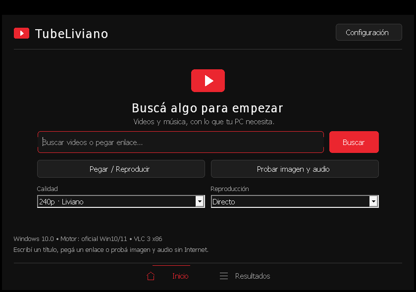

# TubeLiviano 0.5.2 · Win32 x86 portable

Cliente para ver videos con una ventana nativa Win32 y VLC 3 embebido. La interfaz
se dibuja con GDI: inicio centrado, búsqueda, resultados en dos líneas, tema oscuro
o claro y una ventana de Configuración. No usa navegador embebido, imágenes remotas
ni animaciones de interfaz. Los perfiles son **144p**, **240p · Liviano** por defecto
y **360p**; no hay una subida automática a calidades mayores.

El objetivo es **XP SP3 x86 / Atom N270 con 512 MB**, además de Windows 10/11.
**[NO EJECUTADO] XP y Atom físicos:** no hubo hardware disponible para certificar
compatibilidad, RAM o fluidez. Las ejecuciones x64/Wine documentadas son una
variante de validación y no sustituyen el EXE x86 del ZIP.



Captura de la variante de validación x64/Wine; no es una prueba en XP/Atom.

## Descargar, extraer y empezar

El portable se publica en [`releases/`](https://github.com/kbdfh98uv/TubeLiviano/tree/main/releases)
como [**TubeLiviano_Portable_0.5.2_x86.zip**](https://github.com/kbdfh98uv/TubeLiviano/raw/refs/heads/main/releases/TubeLiviano_Portable_0.5.2_x86.zip).

1. Extraé **todo el ZIP en una carpeta nueva**, por ejemplo `E:\TL052`. Entrá en
   la carpeta `TubeLiviano` extraída y abrí `TubeLiviano.exe`. No ejecutes el EXE
   dentro del ZIP ni mezcles DLLs o motores de una versión anterior.
2. Confirmá **0.5.2** en el título. Pulsá **Probar imagen y audio** para ver un
   patrón animado y oír un tono de 440 Hz sin Internet. Probá los tres perfiles.
3. En **Inicio**, escribí un título y pulsá **Buscar** o Enter; también podés usar
   **Pegar / Reproducir** con un enlace de YouTube. **Resultados** muestra título
   y, debajo, canal + duración. Doble clic o **Reproducir** abre el seleccionado.
4. **Cancelar** detiene reproducción y extracción; **Reintentar** conserva el
   enlace. En Resultados, cambiar de calidad reintenta el último video sin pegarlo
   otra vez. Cambiarla en Inicio prepara el próximo video, sin abrir uno anterior.
5. **Inicio** detiene/cancela la actividad y conserva búsqueda, resultados y enlace
   para volver con **Resultados**. **Pausa** pausa/reanuda el video actual.

Atajos: **Ctrl+F** enfoca el buscador, **Ctrl+,** abre Configuración y **Esc**
cancela la actividad. Tab/Mayús+Tab recorren controles; Enter busca desde el
buscador. La ventana admite un área cliente mínima de **660 × 450**; en Windows
con bordes clásicos corresponde aproximadamente a 676 × 489 píxeles externos.

## Configuración portable

Abrí **Configuración** y elegí General, Reproducción o Red. **Guardar** aplica los
cambios; **Cancelar** los descarta. Se guardan junto al EXE en `TubeLiviano.ini`,
sin registro de Windows ni instalación. Si el INI está protegido o la carpeta no
permite escribir, los cambios explícitos se aplican a la sesión y aparece un
aviso; no se sobrescribe el archivo existente.

| Opción | Valores / predeterminado | Cuándo actúa |
| --- | --- | --- |
| Tema / texto | Oscuro por defecto; claro y texto grande opcionales | Al guardar |
| Resultados por búsqueda | 6 o **12** | Próxima búsqueda |
| Calidad | 144, **240**, 360p | Próxima apertura; Guardar puede reiniciar una activa |
| Búfer de red | 250–3000 ms; **450 ms** | Próxima apertura |
| Lectura anticipada | 64, **128**, 256 KiB | Próxima apertura |
| Hilos del decodificador | **1** o 2 | Próxima apertura |
| Volumen / silenciar | 0–100; **80**, sin silencio | Reproductor actual cuando su controlador está libre |
| Espera de búsqueda | 30, 60 o **120 s** | Próxima búsqueda |
| Espera de resolución | 30, 60 o **90 s** | Próxima resolución |
| Conexión | **Directo** o Puente; dirección editable | Selector de modo: próxima petición; Guardar puede reiniciar una activa |
| Recordar tamaño | Activado por defecto | Restaura dimensiones de ventana, no posición |

Guardar una calidad, modo o dirección distintos desde Configuración vuelve a
abrir un video si está activo en Resultados. Los demás cambios de búfer/hilos se
usan al abrir el próximo. El selector de calidad de Resultados permite reintentar
también después de un fallo; el selector de modo prepara la siguiente petición.

**Atom · 240p** prepara 240p, búfer 450 ms, prefetch 128 KiB y un hilo.
**Mínimo · 144p** prepara 144p, 250 ms, 64 KiB y un hilo. Estos botones mantienen
las demás preferencias; pulsá Guardar para aplicar. **Restablecer** prepara los
valores iniciales. No son perfiles de rendimiento medidos en un Atom real.

Un `?token=...` en la dirección del puente sirve **solo durante la sesión**:
la parte de consulta se elimina al escribir o cargar la URL del INI. Debe volver
a introducirse tras reiniciar. No se incluyen cuentas ni cookies de YouTube.

## Motores y reproducción

```text
TubeLiviano.exe                  Frontend x86 nativo
Probar_offline.cmd                Prueba automática local para Windows/XP
vlc/                             LibVLC 3.0.21 x86 y plugins necesarios
engines/xp/yt-dlp.exe             Fork x86 publicado para XP
engines/modern/yt-dlp.exe         Build oficial yt-dlp_x86.exe para Win10/11
runtimes/qjs.exe                  QuickJS pequeño para desafíos JavaScript
media/prueba-{144,240,360}.mp4     Imagen y tono offline
source/                          Código propio MIT, scripts, pruebas y guías
licenses/                        Licencias, procedencia y hashes de terceros
```

La versión del kernel cargado y las APIs presentes deciden el motor. Un kernel
XP nativo 5.1/5.2 usa `engines/xp`; Windows 10/11 usa `engines/modern`, también
cuando un modo de compatibilidad informa otra versión. Un motor ausente o una
carpeta nombrada `yt-dlp.exe` produce un error; nunca se sustituye por el de la otra
carpeta. Vista/7/8 y los sistemas no identificados de forma segura pueden usar
Puente pegando un enlace. El framework XP todavía necesita prueba en XP real.

La aplicación resuelve las URLs con yt-dlp y las abre inmediatamente en libVLC,
sin descargar todo el video ni unir audio/video en disco. El perfil limita altura,
H.264/AAC y hasta 30 fps. El origen directo puede servir HTTP Range; el búfer y
prefetch son pequeños y configurables. Una salida normal `1` del extractor o un
fallo del stream puede disparar un único probing de formatos; timeout, fallo de
lanzamiento, DLL, crash o salida inválida no repiten esa resolución. No se usa
`-F` antes del intento normal.

**Directo sigue siendo experimental:** YouTube puede cambiar sus desafíos,
bloquear solicitudes, devolver 403/429 o exigir verificación. El frontend no
incorpora Python; los ejecutables upstream de yt-dlp sí empaquetan su intérprete.
Por eso el tamaño/consumo total no es el de la ventana Win32. No se descargan
dependencias al iniciar.

## Puente opcional

En otra PC más potente ejecutá el [servidor puente](bridge/README.md) con Python,
FFmpeg y yt-dlp actuales. En la netbook elegí Puente y una dirección como
`http://192.168.1.20:8787`; con token, `http://192.168.1.20:8787?token=clave-local`.
El servidor produce H.264 baseline, YUV420p a **24 fps** y AAC mediante MPEG-TS
temprano. Python y FFmpeg se necesitan en esa PC, no en la netbook. El buscador
sigue usando el motor local; pegar un enlace permite usar el puente directamente.

## Probar, compilar y verificar

En Windows, cerrá otras instancias y ejecutá **`Probar_offline.cmd`** desde la
carpeta extraída. No requiere Python, PowerShell ni Internet. Prueba los tres
clips y deja JSON + `resultado.txt` en una carpeta de `%TEMP%` que muestra al
terminar. Usa audio dummy: después comprobá sonido con el botón offline normal.
El [checklist XP/Atom](docs/PRUEBAS_XP_ATOM.md) contiene pasos exactos y una ficha
para registrar OS, memoria, fluidez, errores y resultados.

Desde Linux, ejecutá desde la raíz del repo o desde `source/` en el ZIP. Se
requieren MinGW-w64 **i686/MSVCRT**, make, Python 3.12+ y FFmpeg/libx264:

```sh
make
python3 scripts/fetch-deps.py --sources
# Con la caché completa: python3 scripts/fetch-deps.py --offline --sources
make clips
python3 -m unittest discover -s tests -p 'test_*.py' -v
python3 tests/engine_native_test.py
cc -std=c99 -fsanitize=address,undefined tests/os_detection_test.c src/os_detect.c -o build/os_detection_native
build/os_detection_native
# Solo con Wine x86 realmente funcional y servidor X:
python3 scripts/verify-offline.py --control-tests
python3 scripts/package.py --slim-vlc
python3 -m unittest discover -s tests -p test_package.py -v
```

`make PREFIX=/ruta/i686-w64-mingw32-` permite otro toolchain. El bootstrap sin root
está en `scripts/bootstrap-tools.sh`. `verify-offline.py --surrogate-x64` permite
validar el mismo código con DLLs x64, y marca ese alcance explícitamente; no
certifica el EXE x86. Los scripts comprueban hashes, PE32, recursos obligatorios
y versiones antes de empaquetar. Los archivos ajenos de la etapa se excluyen y se
informan; las dependencias corruptas o clips faltantes impiden generar el ZIP.

## Release y límites

Las [notas 0.5.2](docs/RELEASE_NOTES_0.5.2.md) describen las correcciones y su
evidencia; el [checkpoint](docs/CHECKPOINT-0.5.2.md) registra el cierre de la sesión.
El tamaño y SHA-256 definitivos están en `releases/SHA256SUMS.txt` y en el informe
de empaquetado. No se promete alcanzar ~40 MB: los dos motores ya ocupan unos
38 MB antes de VLC.

Código propio **MIT**. VLC, yt-dlp, QuickJS y demás componentes conservan sus
licencias; consultá [THIRD_PARTY.md](THIRD_PARTY.md) y el compañero
`TubeLiviano_ThirdParty_Sources_0.5.2.zip`. Las fuentes transitivas y las pruebas
XP/Atom pendientes se explican allí y en las notas; no se declara una certificación
de compatibilidad ni de redistribución completa.
